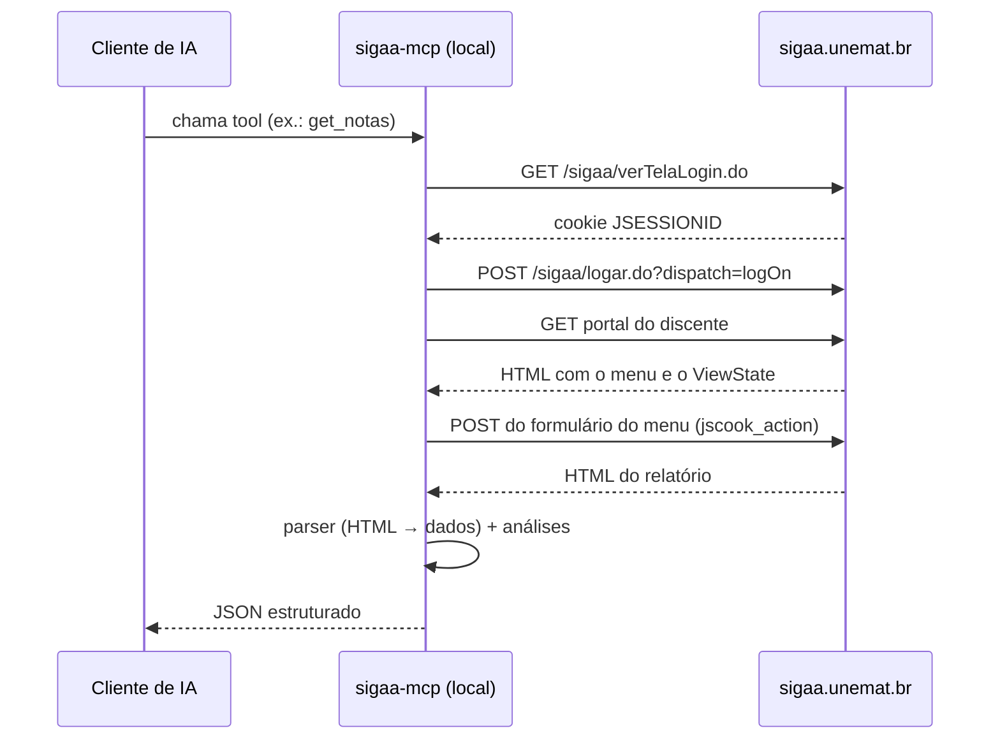

# sigaa-mcp

Conecte o seu assistente de IA (Claude, Cursor, Copilot, OpenCode...) ao **SIGAA** e pergunte em
linguagem natural sobre a sua vida acadêmica:

> *"Quanto eu preciso tirar na última unidade de Cálculo para passar?"*
> *"Quantas faltas ainda posso ter em cada matéria?"*
> *"O que eu tenho para entregar essa semana?"*

O `sigaa-mcp` é um servidor [MCP (Model Context Protocol)](https://modelcontextprotocol.io) que
roda **na sua própria máquina**, entra no SIGAA com o seu login e entrega à IA as suas notas,
frequência, tarefas, provas, notícias das turmas e o calendário acadêmico, já organizados e
com as regras de aprovação da UNEMAT aplicadas.

---

## Sumário

- [Instalação passo a passo](#instalação-passo-a-passo)
  - [1. Pré-requisitos](#1-pré-requisitos)
  - [2. Baixar o projeto](#2-baixar-o-projeto)
  - [3. Testar o acesso ao SIGAA](#3-testar-o-acesso-ao-sigaa)
  - [4. Conectar à sua IA](#4-conectar-à-sua-ia)
- [Exemplos de uso](#exemplos-de-uso)
- [Tools disponíveis](#tools-disponíveis)
- [Regras acadêmicas usadas](#regras-acadêmicas-usadas)
- [Segurança e privacidade](#segurança-e-privacidade)
- [Como funciona por dentro](#como-funciona-por-dentro)
- [Estrutura do código](#estrutura-do-código)
- [Problemas comuns](#problemas-comuns)
- [Limitações](#limitações)
- [Contribuindo](#contribuindo)

---

## Instalação passo a passo

### 1. Pré-requisitos

Você só precisa do **[uv](https://docs.astral.sh/uv/)**, o gerenciador de projetos Python. Ele
baixa sozinho o Python 3.12 e todas as dependências na primeira execução.

**Windows** (PowerShell):

```powershell
powershell -ExecutionPolicy ByPass -c "irm https://astral.sh/uv/install.ps1 | iex"
```

**macOS / Linux**:

```sh
curl -LsSf https://astral.sh/uv/install.sh | sh
```

Feche e abra o terminal e confira:

```sh
uv --version
```

Você também precisa de um login ativo no SIGAA da UNEMAT (o mesmo usuário e senha que usa no
navegador).

### 2. Baixar o projeto

Com git:

```sh
git clone https://github.com/GallegoSz/sigaa-mcp.git
cd sigaa-mcp
```

Ou baixe o ZIP pelo botão **Code → Download ZIP** no GitHub e extraia numa pasta.

Anote o **caminho completo** dessa pasta, ele vai ser usado na configuração da IA. Exemplos:

- Windows: `C:/Users/maria/Documents/sigaa-mcp`
- macOS: `/Users/maria/sigaa-mcp`
- Linux: `/home/maria/sigaa-mcp`

> No Windows, use barras normais (`/`) ou barras duplas (`\\`) nos caminhos dentro de arquivos JSON.

Instale as dependências e **espere terminar** antes de conectar à IA:

```sh
uv sync
```

Na primeira vez o uv baixa o Python e todas as dependências, o que pode levar alguns minutos.
Se isso acontecer só quando a IA iniciar o servidor, alguns clientes desistem antes (timeout) e
o servidor simplesmente não aparece, sem mensagem de erro.

### 3. Testar o acesso ao SIGAA

Antes de conectar a IA, vale confirmar que o login funciona. Copie o arquivo de exemplo:

```sh
cp .env.example .env        # macOS / Linux
copy .env.example .env      # Windows
```

Edite o `.env` com o seu usuário e senha do SIGAA:

```env
SIGAA_USER=seu_login
SIGAA_PASS=sua_senha
```

E rode o teste:

```sh
uv run python testar.py
```

Se tudo estiver certo, aparecem no terminal o calendário acadêmico, as avaliações, a situação
das notas, os alertas de frequência e o resumo da semana, em JSON. Se aparecer
`Falha no login`, confira usuário e senha.

> O `.env` está no `.gitignore` e só é lido pelo `testar.py`. O servidor MCP recebe as
> credenciais pela configuração da IA (próximo passo). Se quiser, apague o `.env` depois do teste.

### 4. Conectar à sua IA

O servidor usa o transporte **stdio**: a IA inicia o processo localmente e conversa com ele.
Por isso ele funciona em **aplicativos e ferramentas instalados no computador** (Claude Desktop,
Claude Code, Cursor, VS Code, OpenCode...), mas **não** nas versões web (claude.ai, chatgpt.com), que só
aceitam servidores remotos.

Em todos os casos, troque:

- `CAMINHO/DO/sigaa-mcp` pelo caminho da pasta do passo 2;
- `seu_login` e `sua_senha` pelas suas credenciais do SIGAA.

Depois de configurar, **reinicie o aplicativo**.

<details open>
<summary><b>Claude Desktop</b> (app do Claude para Windows/macOS)</summary>

1. Abra o Claude Desktop e vá em **Configurações → Desenvolvedor → Editar configuração**.
   Isso abre o arquivo `claude_desktop_config.json`:
   - Windows: `%APPDATA%\Claude\claude_desktop_config.json`
   - macOS: `~/Library/Application Support/Claude/claude_desktop_config.json`
2. Adicione o servidor dentro de `mcpServers` (se o arquivo estiver vazio, use o conteúdo
   inteiro abaixo):

```json
{
  "mcpServers": {
    "sigaa": {
      "command": "uv",
      "args": ["--directory", "CAMINHO/DO/sigaa-mcp", "run", "sigaa-mcp"],
      "env": {
        "SIGAA_USER": "seu_login",
        "SIGAA_PASS": "sua_senha"
      }
    }
  }
}
```

3. Feche o Claude Desktop por completo (inclusive na bandeja do sistema) e abra de novo.
4. Numa conversa nova, clique no ícone de ferramentas: o `sigaa` deve aparecer com as 13 tools.

> Se o servidor não iniciar com erro de `uv` não encontrado, troque `"command": "uv"` pelo
> caminho completo do executável. Descubra com `where uv` (Windows) ou `which uv` (macOS/Linux).
> No Windows costuma ser `C:\\Users\\<voce>\\.local\\bin\\uv.exe`.

</details>

<details>
<summary><b>Claude Code</b> (terminal)</summary>

```sh
claude mcp add sigaa --scope user \
  -e SIGAA_USER=seu_login -e SIGAA_PASS=sua_senha \
  -- uv --directory CAMINHO/DO/sigaa-mcp run sigaa-mcp
```

No PowerShell, escreva tudo numa linha só (sem as `\`).

`--scope user` deixa o servidor disponível em qualquer pasta. Confira com `claude mcp list`
ou com `/mcp` dentro do Claude Code.

</details>

<details>
<summary><b>Cursor</b></summary>

Em **Settings → MCP → Add new global MCP server** (arquivo `~/.cursor/mcp.json`):

```json
{
  "mcpServers": {
    "sigaa": {
      "command": "uv",
      "args": ["--directory", "CAMINHO/DO/sigaa-mcp", "run", "sigaa-mcp"],
      "env": {
        "SIGAA_USER": "seu_login",
        "SIGAA_PASS": "sua_senha"
      }
    }
  }
}
```

</details>

<details>
<summary><b>VS Code</b> (GitHub Copilot, modo agente)</summary>

Crie `.vscode/mcp.json` no seu workspace (ou use **MCP: Add Server** na paleta de comandos).
Aqui o VS Code pede a senha na hora, sem gravá-la no arquivo:

```json
{
  "inputs": [
    { "type": "promptString", "id": "sigaa-user", "description": "Usuário do SIGAA" },
    { "type": "promptString", "id": "sigaa-pass", "description": "Senha do SIGAA", "password": true }
  ],
  "servers": {
    "sigaa": {
      "type": "stdio",
      "command": "uv",
      "args": ["--directory", "CAMINHO/DO/sigaa-mcp", "run", "sigaa-mcp"],
      "env": {
        "SIGAA_USER": "${input:sigaa-user}",
        "SIGAA_PASS": "${input:sigaa-pass}"
      }
    }
  }
}
```

</details>

<details>
<summary><b>OpenCode</b> (terminal, com modelos gratuitos)</summary>

O [OpenCode](https://opencode.ai) é um assistente de terminal que funciona com vários modelos
(Claude, GPT, Gemini e outros) e oferece **alguns modelos gratuitos para testar**, sem precisar
de assinatura. A lista de modelos gratuitos muda com o tempo; veja as opções com `/models`
dentro do OpenCode.

Adicione o servidor no `opencode.json`, global (`~/.config/opencode/opencode.json`) ou na
pasta do projeto:

```json
{
  "$schema": "https://opencode.ai/config.json",
  "mcp": {
    "sigaa": {
      "type": "local",
      "command": ["uv", "--directory", "CAMINHO/DO/sigaa-mcp", "run", "sigaa-mcp"],
      "enabled": true,
      "environment": {
        "SIGAA_USER": "seu_login",
        "SIGAA_PASS": "sua_senha"
      }
    }
  }
}
```

Repare que o formato é diferente dos outros clientes: a chave é `mcp`, o comando e os
argumentos vão juntos numa lista em `command`, e as credenciais ficam em `environment`.

> Se a pasta tiver ao mesmo tempo `opencode.json` e `opencode.jsonc`, mantenha a configuração
> em um só deles. Conteúdo diferente nos dois pode fazer o servidor sumir sem nenhum erro.

</details>

<details>
<summary><b>Outros clientes MCP</b></summary>

Qualquer cliente que suporte servidores MCP locais (stdio) funciona. Os dados são sempre os
mesmos:

| Campo | Valor |
|---|---|
| Comando | `uv` |
| Argumentos | `--directory CAMINHO/DO/sigaa-mcp run sigaa-mcp` |
| Variáveis de ambiente | `SIGAA_USER`, `SIGAA_PASS` e, opcionalmente, `SIGAA_URL` |

</details>

---

## Exemplos de uso

Depois de conectado, é só conversar. A IA escolhe quais tools chamar.

| Você pergunta | A IA usa |
|---|---|
| "Como estão minhas notas esse semestre?" | `get_notas` |
| "Quanto preciso tirar na U3 de Física pra passar direto?" | `get_situacao_notas` |
| "Em qual matéria eu tô mais perto de reprovar por falta?" | `get_alertas_frequencia` |
| "O que tenho pra fazer nos próximos 10 dias?" | `get_resumo_semana(dias=10)` |
| "Tem alguma tarefa de Algoritmos que eu ainda não enviei?" | `get_tarefas("algoritmo")` |
| "Quando é a próxima prova de Cálculo?" | `get_avaliacoes("calculo")` |
| "O professor de Física postou alguma coisa nova?" | `get_noticias("fisica")` |
| "Qual o último dia pra trancar matrícula?" | `get_calendario_academico` |
| "Qual meu CRA e quanto falta pra eu me formar?" | `get_dados_discente` |

Exemplo de resposta de `get_alertas_frequencia`:

```json
[
  {
    "disciplina": "CÁLCULO DIFERENCIAL E INTEGRAL I",
    "faltas": 8,
    "aulas_carga_horaria": 72,
    "percentual_presenca_aulas_ministradas": 83,
    "limite_faltas": 18,
    "faltas_restantes": 10,
    "aulas_por_encontro": 4,
    "encontros_que_ainda_pode_faltar": 2,
    "status": "ok"
  }
]
```

---

## Tools disponíveis

### Dados do portal

| Tool | O que retorna |
|---|---|
| `get_notas(semestre?)` | Notas por semestre: unidades, recuperação, prova final, resultado, faltas, situação. Filtro opcional no formato `2026.2` |
| `get_turmas()` | Turmas do semestre atual (componente, local, horário) |
| `get_dados_discente()` | Matrícula, curso, status, e-mail, entrada, CRA, carga horária pendente, % integralizado |
| `get_agenda()` | Tarefas e avaliações com data e dias restantes (bloco "Minhas atividades" do portal) |
| `get_calendario_academico(semestre?)` | Período letivo, consolidação, trancamento, matrícula etc. do calendário do seu curso |

### Dados das turmas virtuais

| Tool | O que retorna |
|---|---|
| `get_frequencia(disciplina?)` | Presença/faltas por aula e percentuais de frequência de cada turma |
| `get_tarefas(disciplina?)` | Tarefas: prazo, se vale nota, se já foi enviada, se ainda aceita envio, enunciado |
| `get_noticias(disciplina?)` | Notícias publicadas pelos professores (título e data) |
| `get_avaliacoes(disciplina?)` | Datas e horários das provas marcadas |
| `get_conteudo(disciplina?)` | Tópicos de aula (cronograma com datas, descrição e materiais) |

O parâmetro `disciplina` aceita **parte do nome**, sem diferenciar acentos nem maiúsculas
(`"calculo"` encontra "CÁLCULO DIFERENCIAL E INTEGRAL I"). Sem filtro, a tool percorre todas
as turmas, o que pode levar alguns segundos.

### Análises

| Tool | O que retorna |
|---|---|
| `get_situacao_notas()` | Para cada disciplina em andamento: média parcial e quanto precisa tirar nas unidades restantes para aprovar direto ou ir ao exame final |
| `get_alertas_frequencia()` | Limite de faltas, faltas restantes, quantos encontros ainda pode faltar e um status (`ok`, `atenção`, `crítico`, `REPROVADO POR FALTA`) |
| `get_resumo_semana(dias=7)` | Agenda dos próximos dias, tarefas abertas ainda não enviadas, notícias recentes e só os alertas de frequência que não estão `ok` |

> Em `get_notas`, o campo `faltas` só vem preenchido em disciplinas já consolidadas. Enquanto a
> turma está em andamento ele vem `null`, porque o relatório do SIGAA mostra 0 até a
> consolidação. Para o semestre atual, use `get_frequencia`.

---

## Regras acadêmicas usadas

As análises seguem a **Resolução nº 001/2024-CONEPE** (Normatização Acadêmica da UNEMAT):

| Artigo | Regra | Onde é usada |
|---|---|---|
| Art. 61 | Média semestral ≥ 6,0 aprova. Com frequência ≥ 75% e média entre 4,0 e 5,9, o aluno vai para o exame final, onde precisa de nota ≥ 5,0 | `get_situacao_notas` |
| Art. 43 | Frequência abaixo de 75% da carga horária presencial reprova, independentemente da nota | `get_alertas_frequencia` |
| Art. 40 | Faltas não são abonadas | `get_alertas_frequencia` |

Como os cálculos são feitos:

- **Média:** média aritmética das unidades (padrão do SIGAA). O plano de curso de uma
  disciplina pode definir pesos diferentes; nesse caso o resultado é uma estimativa.
- **Nota necessária:** `(meta × total_de_unidades − soma_das_notas_lançadas) ÷ unidades_restantes`,
  para a meta 6,0 (aprovar) e 4,0 (exame final).
- **Limite de faltas:** `⌊ aulas_da_carga_horária × 25% ⌋`.
- **Encontros que ainda pode faltar:** faltas restantes divididas pelo número de aulas de cada
  encontro, já que faltar num dia conta todas as aulas daquele dia.

Os números são um apoio. A palavra final é sempre do SIGAA e da coordenação do curso.

---

## Segurança e privacidade

- **Tudo roda no seu computador.** O servidor conversa diretamente com `sigaa.unemat.br`.
  Nenhum dado passa por servidores de terceiros, exceto o que a própria IA recebe para
  responder (as respostas das tools vão para o provedor da IA que você usa, como em qualquer
  conversa).
- **Somente leitura.** Nenhuma tool envia, altera ou apaga nada no SIGAA.
- **Sua senha fica no arquivo de configuração do cliente** (ex.: `claude_desktop_config.json`)
  em texto puro. Não compartilhe esse arquivo nem tire print dele. No VS Code dá para usar
  `inputs` para não gravar a senha (veja acima). Em qualquer cliente, outra opção é definir
  `SIGAA_USER` e `SIGAA_PASS` como variáveis de ambiente do sistema e omitir o bloco `env`
  (no Windows: `setx SIGAA_PASS "sua_senha"` e reabra o cliente; no macOS/Linux, `export`
  no perfil do shell). O cliente precisa ter sido aberto depois de definir as variáveis.
- **Nunca suba o `.env`** para o GitHub. Ele já está no `.gitignore`.
- **Não hospede este servidor para outras pessoas.** Ele foi feito para um único aluno por
  instalação: as credenciais vêm de variáveis de ambiente e não há autenticação. Se ele for
  exposto na internet, quem tiver o endereço acessa os dados de quem o configurou.
- **Conteúdo de terceiros:** enunciados de tarefas e notícias são escritos pelos professores e
  repassados à IA como estão. Trate-os como informação, não como instruções.

---

## Como funciona por dentro

O SIGAA não tem API pública. O servidor se comporta como um navegador: faz login, guarda o
cookie de sessão, "clica" nos menus enviando os mesmos formulários que a página enviaria e lê
o HTML que volta.



### Login e sessão

1. `GET /sigaa/verTelaLogin.do` cria a sessão (cookie `JSESSIONID`).
2. `POST /sigaa/logar.do?dispatch=logOn` com `user.login` e `user.senha`.
3. Se a resposta ainda for a tela de login, o servidor reporta `Falha no login`.

O login acontece uma vez e é reaproveitado. Se a sessão expirar, o cliente detecta a tela de
login no meio do caminho e entra de novo automaticamente.

### Navegação JSF

O SIGAA é feito em JSF (JavaServer Faces). Cada link é, na prática, o envio de um formulário
com campos ocultos, e um deles, o `javax.faces.ViewState`, **muda a cada requisição**. Por isso
o servidor sempre lê os campos da página mais recente antes de "clicar":

- **Menu do portal** (`menu:form_menu_discente`): os itens são montados em JavaScript
  (JSCookMenu). O valor de `jscook_action` de cada item ("Consultar Minhas Notas",
  "Calendário Acadêmico"...) é encontrado pelo texto do item, porque o id gerado pelo JSF muda
  entre versões do sistema.
- **Links `h:commandLink`**: os parâmetros que o link enviaria ficam no `onclick`
  (`jsfcljs(form, {...})`). O parser extrai esses pares e os adiciona ao formulário.

### Turmas virtuais

Para frequência, tarefas, notícias, avaliações e conteúdo, o servidor:

1. Abre o portal e encontra os formulários `form_acessarTurmaVirtual*` de cada turma.
2. Entra na turma (a página inicial já traz o conteúdo/tópicos de aula).
3. Clica nos itens do menu lateral (`formMenu`) pelo texto: "Frequência", "Tarefas"...
4. Volta ao portal e repete para a próxima turma.

Cada item de cada turma fica em **cache por 2 minutos**, e `get_resumo_semana` entra uma vez
em cada turma e coleta tudo o que precisa em sequência, para não repetir navegação.

As requisições passam por um *lock*: como a sessão JSF tem estado, duas navegações ao mesmo
tempo corromperiam o `ViewState`, então elas acontecem uma de cada vez.

### Calendário acadêmico

A busca de calendários exige filtros. O servidor escolhe a modalidade **Presencial** e o
**convênio** que aparece no nome do seu curso (ex.: `... - CONTÍNUA - N`), já que sem o
convênio o SIGAA só lista calendários antigos. Depois seleciona o calendário do semestre
pedido (ou o atual).

---

## Estrutura do código

```
sigaa-mcp/
├── src/sigaa_mcp/
│   ├── server.py    # Definição das tools MCP (o que a IA enxerga)
│   ├── client.py    # Cliente HTTP: login, sessão, navegação JSF, cache e lock
│   ├── parser.py    # HTML do SIGAA → dicionários Python
│   └── analise.py   # Regras da UNEMAT: situação de notas, frequência, resumo
├── tests/           # Testes automatizados (pytest), sem rede e sem login
├── testar.py        # Teste rápido contra o SIGAA real, sem MCP
├── .env.example     # Modelo de credenciais para o testar.py
├── pyproject.toml   # Metadados e dependências
└── uv.lock          # Versões exatas das dependências
```

As camadas são separadas de propósito:

| Arquivo | Responsabilidade | Depende de |
|---|---|---|
| `server.py` | Expõe as tools via `MCPServer`. Cada tool tem docstring e parâmetros tipados, que viram a descrição que a IA lê para decidir quando usá-la. Cria o cliente sob demanda a partir das variáveis de ambiente | `client`, `analise` |
| `client.py` | `SigaaClient`: um `httpx.AsyncClient` com cookies, que sabe logar, abrir o portal, acionar itens de menu, clicar em `commandLink`s e varrer as turmas virtuais. Detecta charset (o SIGAA às vezes não declara no header) e reloga quando a sessão cai | `parser` |
| `parser.py` | Funções puras que recebem HTML e devolvem dados: formulários JSF, menus, tabelas de notas, frequência, tarefas, notícias, avaliações, tópicos, calendário. Usa `selectolax` (parser rápido baseado no Lexbor) e normaliza datas para ISO 8601 | — |
| `analise.py` | Funções puras de regra de negócio sobre os dados já extraídos. Não faz rede | — |

Como `parser.py` e `analise.py` não acessam a rede, dá para testá-los com HTML salvo ou
dados de exemplo. Os arquivos `*.html` estão no `.gitignore` justamente para que páginas
salvas durante o desenvolvimento (que contêm dados pessoais) nunca sejam publicadas.

### Dependências

| Pacote | Para quê |
|---|---|
| [`mcp`](https://github.com/modelcontextprotocol/python-sdk) | SDK oficial do Model Context Protocol |
| [`httpx`](https://www.python-httpx.org/) | Cliente HTTP assíncrono com cookies e redirecionamentos |
| [`selectolax`](https://github.com/rushter/selectolax) | Parser de HTML rápido com seletores CSS |

### Adicionando uma nova tool

1. Se a página ainda não é lida, crie a função `parse_*` em `parser.py`.
2. Exponha a navegação em `client.py` (um item de menu com `_acao_menu`, ou um item de turma
   virtual registrado em `_ITENS_TURMA`).
3. Crie a função em `server.py` com `@mcp.tool()`, docstring clara e argumentos tipados.
4. Escreva o teste em `tests/` (HTML sintético para o parser) e rode `uv run pytest`.
5. Teste pelo `testar.py` antes de testar pela IA.

---

## Problemas comuns

| Sintoma | Causa provável e solução |
|---|---|
| `Defina as variáveis de ambiente SIGAA_USER e SIGAA_PASS` | O bloco `env` não foi configurado no cliente de IA, ou o nome das variáveis está diferente |
| `Falha no login: verifique SIGAA_USER e SIGAA_PASS` | Usuário ou senha errados. Teste o mesmo login no navegador |
| `Portal do discente não carregou` | O SIGAA está mostrando uma tela intermediária (questionário, aviso, atualização de dados). Entre pelo navegador, resolva a tela e tente de novo |
| `Nenhuma turma corresponde a '...'` | O filtro de disciplina não bateu com nenhum nome. A própria mensagem lista as turmas disponíveis. O filtro procura o texto dentro do nome, então prefira um trecho curto (`"algoritmo"` em vez de `"algoritmos"`) |
| `Calendário de 2026.2 não encontrado` | O calendário do semestre ainda não foi publicado. A mensagem lista os disponíveis |
| O servidor não aparece na IA | Reinicie o aplicativo por completo. Confira se o caminho em `--directory` existe e se o `uv` está no PATH (ou use o caminho completo). Rode `uv sync` antes, para a primeira inicialização não estourar o tempo do cliente. Como alternativa ao `uv run`, aponte direto para o executável do ambiente: `CAMINHO/DO/sigaa-mcp/.venv/Scripts/sigaa-mcp.exe` (Windows) ou `.venv/bin/sigaa-mcp` (macOS/Linux) |
| A primeira chamada demora | Na primeira execução o uv baixa o Python e as dependências. Tools sem filtro de disciplina também visitam todas as turmas |
| Dados estranhos ou vazios numa tool | O layout de alguma página do SIGAA pode ter mudado. Abra uma issue dizendo qual tool e o que apareceu (sem dados pessoais) |

---

## Limitações

- Feito e testado para o **SIGAA da UNEMAT**, no **portal do discente**. A variável `SIGAA_URL`
  permite apontar para outra instituição, mas cada SIGAA tem personalizações e os parsers podem
  não funcionar.
- Depende do HTML do SIGAA. Se a universidade mudar o layout, partes podem quebrar até o
  parser ser ajustado.
- A média usada nas análises é aritmética; disciplinas com pesos diferentes no plano de curso
  terão resultados aproximados.
- Somente leitura: não envia tarefas, não faz matrícula, não altera nada.
- Um usuário por instalação.

Este é um projeto independente, feito por aluno, **sem vínculo com a UNEMAT** nem com os
desenvolvedores do SIGAA. Use por sua conta e com moderação.

---

## Contribuindo

Issues e pull requests são bem-vindos, principalmente para:

- ajustes quando o SIGAA mudar alguma página;
- novas tools (histórico, declarações, horários...);
- suporte a SIGAAs de outras instituições.

Ao reportar um problema, **nunca** cole HTML, prints ou JSON com dados pessoais (nome,
matrícula, notas). Descreva o que esperava e o que aconteceu.

Para desenvolver:

```sh
uv sync
uv run pytest            # testes automatizados, não acessam o SIGAA
cp .env.example .env     # preencha com suas credenciais
uv run python testar.py  # teste contra o SIGAA real
```

Os testes em `tests/` cobrem as quatro camadas: `test_parser.py` e `test_analise.py` usam HTML e
dados sintéticos; `test_client.py` roda o `SigaaClient` contra um SIGAA falso
(`httpx.MockTransport`) que simula login, sessão expirada, troca de `ViewState` a cada página,
turmas virtuais e calendário; `test_server.py` confere o registro e o schema das tools.

Para testar as tools numa interface visual, use o MCP Inspector:

```sh
npx @modelcontextprotocol/inspector uv --directory . run sigaa-mcp
```

(defina `SIGAA_USER` e `SIGAA_PASS` no ambiente ou na tela do Inspector).
